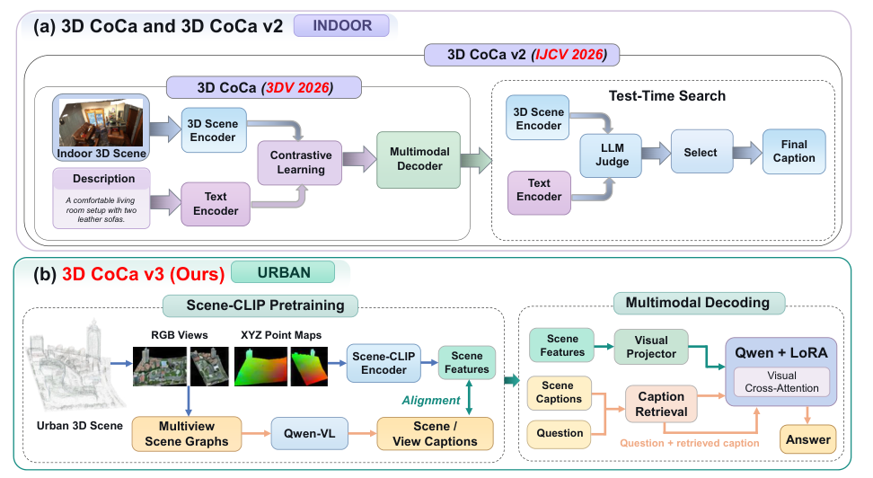
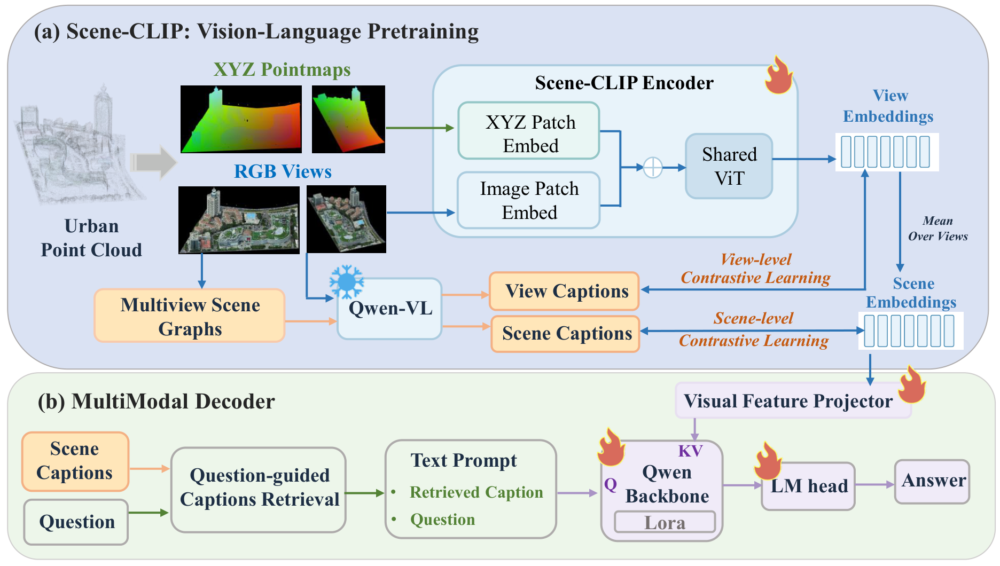

<div align="center">

<h1>3D CoCa v3: Contrastive Learners with Scene Graphs for Urban Scene Understanding</h1>

<p><strong>Scene-graph-enhanced contrastive pretraining and multimodal decoding for urban 3D understanding.</strong></p>

<p>
  
</p>

</div>

3D CoCa v3 extends contrastive and generative 3D vision-language learning to large-scale urban scenes. It learns geometry-aware representations from aligned multi-view RGB images and XYZ point maps, uses multi-view scene graphs (MSG) to provide structured relational descriptions, and answers urban scene questions with a multimodal decoder conditioned on visual features and question-relevant captions.

The paper reports **88.35% sentence-wise** and **64.79% city-wise** overall top-1 accuracy on City-3DQA, improving over 3D CoCa v2 by 20.88 and 3.57 percentage points, respectively.

## Framework

The model is trained in two stages. Scene-CLIP pretraining aligns view- and scene-level language with geometry-aware features from multi-view RGB and point maps. Multimodal decoding retrieves a question-relevant scene caption and combines it with projected visual features in a LoRA-adapted Qwen backbone.

<p align="center">
  
</p>

## City3D-9.6K

City3D-9.6K extends 193 City-3DQA urban scenes with 50 rendered viewpoints per scene. It contains 9,650 RGB views and aligned XYZ point maps, view captions, multi-view scene graphs, and scene-level captions. The annotations provide complementary visual, geometric, semantic, and relational supervision for the two training stages.

## Checkpoints

The released Scene-CLIP pretraining and multimodal decoding checkpoints can be downloaded from the [3D CoCa v3 Hugging Face repository](https://huggingface.co/AIGeeksGroup/3DCoCav3/tree/main).

| Stage | Checkpoint |
|---|---|
| Scene-CLIP pretraining | [Download from Hugging Face](https://huggingface.co/AIGeeksGroup/3DCoCav3/tree/main) |
| Multimodal decoding | [Download from Hugging Face](https://huggingface.co/AIGeeksGroup/3DCoCav3/tree/main) |

The decoding scripts also require the local Qwen base model configured by `QWEN_MODEL_PATH` (the default is `pretrained/Qwen3.8-2B-Distill`). This is separate from the 3D CoCa v3 task checkpoint.

## Environment Setup

### Scene-CLIP pretraining

The Scene-CLIP environment follows [UniScene3D](https://github.com/Yebulabula/UniScene3D). The reference setup uses Python 3.10, PyTorch 2.5.1, and torchvision 0.20.1; install the remaining pinned packages from this repository's `requirements.txt`.

```bash
conda create -n uniscene3d python=3.10 -y
conda activate uniscene3d
pip install torch==2.5.1 torchvision==0.20.1
pip install -r requirements.txt
```

Choose PyTorch wheels compatible with your CUDA version. The training launcher uses Accelerate for multi-GPU execution.

### Multimodal decoding

The Qwen decoding launcher activates the `Q3VL` Conda environment when Conda is available. Use an environment with PEFT installed and `transformers>=5.15.0`, as checked by the launcher. The decoder-stage transformer requirement differs from the Scene-CLIP pretraining pins in `requirements.txt`; keep the stages in compatible environments.

## Training

### Stage 1: Scene-CLIP Pretraining

Configure the local data and initialization paths in `configs/city3dqa1_pretrain_pt.yaml`, then run:

```bash
bash scripts/pretraining/pretrain_city3dqa1.sh
```

The launcher is configured for four GPUs (`CUDA_VISIBLE_DEVICES=0,1,2,3`) and writes logs under `logs/` and experiment outputs under `results/`. Edit the script to select different GPUs; `GPU_PER_NODE` and `PORT` can be set through the environment.

### Stage 2: Multimodal Decoding

Choose a training script from `scripts/vqa3d/` in the source archive for the desired decoder setup. For question-guided caption retrieval with Qwen visual cross-attention, for example:

```bash
bash scripts/vqa3d/city3dqa1.sh
```

Before running, set the QA, rendered-view, caption, FG-CLIP feature, Qwen model, and output paths in the script or through its supported environment variables. The launcher is configured for four GPUs (`CUDA_VISIBLE_DEVICES=0,1,2,3`); edit it to match your node. Training logs and checkpoints are written under `OUTPUT_ROOT`.

Other scripts in `scripts/vqa3d/` cover additional caption sources, decoder variants, and inference/evaluation runs.

## Citation

If you use this work, please cite:

```bibtex
@misc{3dcocav3,
  title        = {3D CoCa v3: Contrastive Learners with Scene Graphs for Urban Scene Understanding},
  year         = {2027},
}
```
